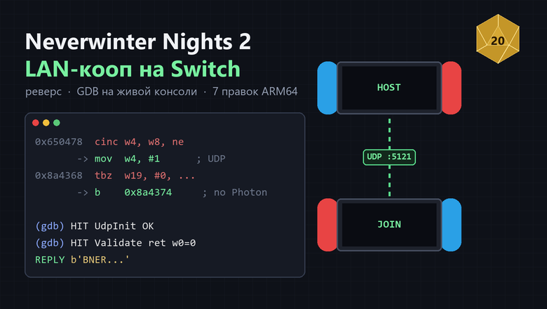

📖 **Статья на Хабре / Article (RU):** [Как я вернул LAN-кооп в Neverwinter Nights 2 на Switch](https://habr.com/ru/articles/1092982/)

# Neverwinter Nights 2 EE — LAN co-op for Nintendo Switch (Atmosphere)

**[Русский](#русский) · [English](#english)**

---

## Русский

Мод возвращает в Switch-версию **Neverwinter Nights 2: Enhanced Edition** игру по **локальной сети** между консолями. Аккаунт Nintendo, подписка NSO и онлайн-сервисы не нужны. Заодно в комплекте есть необязательный пресет «ультра»-графики.

В оригинале сетевая игра на Switch идёт только через онлайн-сервис (Photon) со входом в аккаунт Nintendo. На прошитых консолях она поэтому не работает: игра просит сервисы Nintendo или пишет «онлайн-службы недоступны». Внутри игры есть полноценный LAN-режим, как на ПК, но на Switch он спрятан и отключён. Этот мод его включает.

### Требования
- Switch с **Atmosphere** (CFW). Мод ставится на **все консоли**, которые играют вместе.
- **NWN2 EE** (TitleID `01008E601E03C000`) с обновлением **v65536**. Патч привязан к сборке игры: build ID `3554C29951DDA41FE0AF61D3888DC3BB019764CA`. На другой версии он просто не применится.
- Консоли в одной сети (одна Wi-Fi или LAN).

### Установка
1. Скопируйте содержимое папки **`SD/`** в **корень карты памяти**, с заменой. Должно получиться:
   ```
   atmosphere/exefs_patches/nwn2_lan/3554C29951DDA41FE0AF61D3888DC3BB019764CA.ips
   atmosphere/contents/01008E601E03C000/romfs/ui/default/enhanced/ee_multiplayermenu.xml
   atmosphere/contents/01008E601E03C000/romfs/ui/default/enhanced/ee_multiplayerbrowser.xml
   ```
2. Если есть файл `atmosphere/contents/01008E601E03C000/romfs_metadata.bin`, удалите его. Это кэш Atmosphere, он пересоздастся сам.
3. **Рекомендуется:** если стоит SaltyNX или FPSLocker, исключите игру. Добавьте в `SaltySD/exceptions.txt` строку
   ```
   X01008E601E03C000
   ```
4. Полностью перезапустите игру.

### Как играть
- **Хост:** Главное меню → **Мультиплеер** → **Новая игра** (или «Загрузить») → кампания → запуск сервера. Пройдите до самой игры.
- **Второй игрок:** Главное меню → **Мультиплеер** → **Прямое подключение** → IP консоли хоста (Настройки системы → Интернет → Состояние подключения → IP-адрес). Порт указывать не нужно, по умолчанию 5121.
- Персонажа второй игрок выбирает или создаёт уже при входе на сервер.

### Что меняет мод
| Где | Что |
|---|---|
| `.ips` (код игры) | убирает системный запрос аккаунта Nintendo и проверку онлайн-служб перед мультиплеером |
| | кнопка «Мультиплеер» открывает меню сразу, без входа в Photon, и включает сетевой режим |
| | сервер и клиент работают по прямому UDP (порт 5121), а не через Photon |
| | сервер не отклоняет игрока с «таким же именем» (без аккаунта Nintendo служебное имя у всех консолей одинаковое) |
| меню (`.xml`) | возвращает скрытые на Switch кнопки **LAN** и **Прямое подключение**, вкладку LAN в браузере серверов |

### Известные ограничения
- **Список во вкладке LAN бывает пустым.** Пользуйтесь «Прямым подключением» по IP, оно работает.
- После захода в «Мультиплеер» игра до перезапуска считает себя сетевой: в списке «Новой игры» могут пропасть одиночные кампании. Перезапустите игру.
- Игра через интернет (Photon) этим модом **не** включается. Только локальная сеть.

### Необязательно: «ультра»-графика
На Switch настройки графики занижены: текстуры грузятся в половинном разрешении, нет дальних теней и сглаживания, дальность 70%. В `extras/graphics_ultra/nwn2.ini` лежит пресет с полными текстурами, анизотропией 16, рельефом земли, отражениями воды, всеми тенями (2048), MSAA 4x, HDR и дальностью 100%. На Switch игра идёт с ним плавно.

Этот файл лежит **в сохранениях игры**, а не на карте:
- **DBI** (MTP): `Saves → Installed games → Dungeons & Dragons Neverwinter Nights 2 Enhanced Edition → <ваш профиль> → nwn2.ini`. Замените файл. Сначала сохраните оригинал.
- Или через **JKSV**: сделайте бэкап сохранения, замените в нём `nwn2.ini`, восстановите бэкап.

Не меняйте графику в меню самой игры: она может перезаписать файл.

### Для исследователей: отладка на живой консоли
В папке [`tools/debug/`](tools/debug/) лежат инструменты, которыми искались правки патча: скрипт для отладчика Atmosphere (gdbstub). Он находит NWN2 на консоли, учитывает ASLR и ставит «тихие» брейкпоинты, которые пишут в лог вызовы сетевого кода. Там же прокси до консоли и проверка LAN-сервера с ПК. Это пригодится, чтобы перенести патч на другую версию игры или разобраться, почему что-то не работает. Подробности в [`tools/debug/README.md`](tools/debug/README.md). Обычному игроку это не нужно.

### Удаление
Удалите `atmosphere/exefs_patches/nwn2_lan/` и `atmosphere/contents/01008E601E03C000/`.

### Важно
- Нужна ваша собственная копия игры. Файлов игры здесь нет, кроме двух изменённых UI-файлов меню.
- Используйте на свой риск. Сломать игру мод не может: всё удаляется двумя папками.

---

## English

This mod brings back **local network (LAN) co-op** between consoles in the Switch version of **Neverwinter Nights 2: Enhanced Edition**. No Nintendo Account, NSO subscription or online services needed. An optional "ultra" graphics preset is included.

On Switch the stock multiplayer only works through an online service (Photon) with Nintendo Account login, so on CFW consoles it fails ("online services unavailable"). The game still contains a full LAN mode like on PC, but it is hidden and disabled on Switch. This mod enables it.

### Requirements
- Switch with **Atmosphere**. Install on **every console** that plays together.
- **NWN2 EE** (TitleID `01008E601E03C000`) with update **v65536** (build ID `3554C29951DDA41FE0AF61D3888DC3BB019764CA`). The patch is tied to this build; other versions simply ignore it.
- Consoles on the same network.

### Install
1. Copy the contents of **`SD/`** to the **root of the SD card**, overwriting.
2. Delete `atmosphere/contents/01008E601E03C000/romfs_metadata.bin` if it exists (Atmosphere rebuilds it).
3. **Recommended:** if you use SaltyNX or FPSLocker, add `X01008E601E03C000` to `SaltySD/exceptions.txt`.
4. Fully restart the game.

### How to play
- **Host:** Main menu → **Multiplayer** → **New Game** (or Load) → pick campaign → start the server, play into the game.
- **Second player:** Main menu → **Multiplayer** → **Direct Connect** → host console's IP (System Settings → Internet → Connection Status). The port is optional, default 5121.

### What it changes
- Code patch (`.ips`):
  - skips the Nintendo Account prompt and the online-services check;
  - opens the multiplayer menu directly in network mode, without Photon;
  - forces direct UDP transport (port 5121) for server and client;
  - skips the duplicate-player-name rejection (without a Nintendo Account all consoles send the same login name).
- UI (`.xml`): restores the **LAN** and **Direct Connect** buttons and the LAN tab hidden on Switch.

### Known limitations
- The LAN tab list may stay empty. Use **Direct Connect** by IP.
- After entering Multiplayer the game stays in network mode until restart, so single-player campaigns may be missing from New Game. Restart the game.
- Internet (Photon) play is **not** enabled, LAN only.

### Optional: ultra graphics
Stock Switch settings are lowered: half-resolution textures, no far shadows, no AA, 70% draw distance. `extras/graphics_ultra/nwn2.ini` raises everything (full textures, 16x aniso, all shadows at 2048, MSAA 4x, HDR, water reflections, normal-mapped terrain, 100% draw distance) and runs smoothly on Switch. Replace `nwn2.ini` inside the game's **save data** (DBI: `Saves → Installed games → … → <profile> → nwn2.ini`, or via a JKSV backup/restore). Back up the original first.

### For researchers: live debugging
[`tools/debug/`](tools/debug/) contains the tooling used to find the patch: a helper for the Atmosphere gdbstub that finds NWN2 on the console, handles ASLR and sets silent logging breakpoints on the network code, plus a gdbstub proxy and a LAN server probe. Useful for porting the patch to another game version. See [`tools/debug/README.md`](tools/debug/README.md).

### Uninstall
Delete `atmosphere/exefs_patches/nwn2_lan/` and `atmosphere/contents/01008E601E03C000/`.

You need your own copy of the game. No game files are included except two modified menu UI files.

---

**License / Лицензия:** [MIT](LICENSE) — covers the patch, presets and docs of this repo. Neverwinter Nights 2 and its original files belong to their owners (Obsidian / Aspyr / Wizards of the Coast); the two menu `.xml` files are modified copies of game UI files, provided only for use with your own copy of the game.
